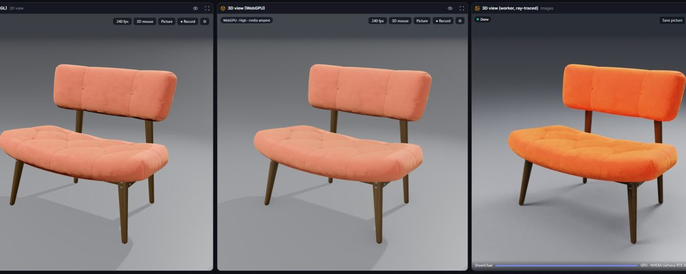

<!-- esasim: cover -->

<!-- /esasim: cover -->

<!-- Banner: upload a picture named banner.png under Data › Readme pictures (the three views side by side work well), then:  -->

# 3D views compared

**One model, three ways to draw it: EsaSim's three rendering blocks side by side, on the same stage, from the same camera, so you can compare them.**

This project is a demo, not a tool: it does nothing but show the three rendering blocks at work and let you compare them. Pick one of 20 high-end sample models; the **3D view (WebGL)** and the **3D view (WebGPU)** draw it in your browser in real time, and the **3D view (worker, ray-traced)** renders it on a machine, with physically based light. Move the camera in any view and the others follow.

    

## Overview

EsaSim has three blocks that draw 3D models, each with its own trade-off between speed and fidelity:

| Block | Where it draws | How | Good for |
|---|---|---|---|
| **3D view (WebGL)** | the browser, on the viewer's graphics card | rasterization with WebGL, the long-standing 3D view of EsaSim | every computer and browser; scenes, robots, simulations, live data |
| **3D view (WebGPU)** | the browser, on the viewer's graphics card | rasterization with WebGPU (WebGL 2 where WebGPU is missing), with temporal anti-aliasing, ambient occlusion and soft shadows | sharper materials and light, still in real time |
| **3D view (worker, ray-traced)** | a worker: any GPU, a Tenstorrent card or the CPU | EsaSim's own path tracer: light followed bounce by bounce, then denoised | the most faithful picture: glass, metal, fabric, soft shadows and light between surfaces; seconds per picture, not frames per second |

To make the comparison fair, the three views share one **stage**: the model sits in the same place, on the same floor, lit by the same lights (the studio's soft boxes) and seen through the same camera. What differs is only how each block turns that into pixels.

## Flows

### Compare the renderers

[**Open the blueprint →**](https://esacode.com/app/projects/26/flows/95)

| Block | What it does |
|---|---|
| **Download the 20 models** | Downloads the 20 models from the Khronos glTF Sample Assets (185 MB) once and keeps them in the project's assets, under `models/`. |
| **Models** | The list of models in the View: a click shows that model in all three views. |
| **3D view (WebGL)** | The model on the EsaSim stage, drawn with WebGL. |
| **3D view (WebGPU)** | The same model, stage and camera, drawn with WebGPU. |
| **3D view (worker, ray-traced)** | Follows the WebGPU view: when the model changes or the camera stops, it renders that picture on the worker, at the view's size. |
| **3D view (worker, ray-traced)** (Images) | Shows the render as it refines, edge to edge, with its device and render time by the progress bar. |

## The View

- **Models**: pick a model; it loads in turn, first in the WebGL view, then in the WebGPU view, then the worker renders it, so the views do not wait for each other.
- **Linked cameras**: drag, scroll or fly with a 3D mouse in either live view and the other follows; when the camera stops, the ray-traced view renders the same picture.
- **3D view (WebGL)** and **3D view (WebGPU)**: frames per second, **3D mouse**, **Picture** (PNG, JPEG or WebP) and **Record** (a video of the view as it plays). The WebGPU view's badge says which renderer and quality it uses and your graphics card; its **⚙** sets quality, exposure, bloom and turntable.
- **3D view (worker, ray-traced)**: the picture sharpens as the samples add up, from a rough preview in a second to the finished render. Under the picture: the model, the progress and where and how fast it was made (for example *GPU · NVIDIA GeForce RTX 3070 · rendered in 16 s*).
  - **⚙**: the device (auto, GPU, CPU, Tenstorrent), quality, samples, bounces, antialiasing, denoiser, bright speckles and resolution, which render the picture again; and the post-processing of the final frame (tone mapping, exposure, contrast, saturation, temperature, bloom, sharpen, vignette, grain), applied to it at once without rendering again.
  - **Save picture**: the render as it is, in PNG.
  - **Record**: each picture finished while it is on becomes part of a video, which comes to the view to play and download when Record is pressed again.

### What to look at

- **Glass**: the dome over the olives, the water bottle, the lantern and the lamp's globe: refraction, reflections at grazing angles, and what shows through.
- **Thin films**: the iridescent dish, the lamp and the bulb inside it change colour with the angle.
- **Fabric**: the velvet sofa, the silk pouf, the chair and the toy car's cloth: a soft sheen along folds and edges.
- **Metal and coats**: the toy car's clear-coated paint, chrome, brushed and anisotropic metal (the barn lamp).
- **Light between surfaces**: soft contact shadows, and colour bounced from one surface onto another, which only the ray-traced view computes.

## Where it runs

- **3D view (WebGL)** and **3D view (WebGPU)**: in the browser, on the graphics card of whoever looks at the View, not on the worker. WebGPU needs a recent Chrome, Edge or Safari; elsewhere the WebGPU view draws with WebGL 2 and its badge says so.
- **3D view (worker, ray-traced)**: on the worker, with no other program to install:
  - **any GPU** (NVIDIA, AMD, Intel, Apple), through WebGPU (Vulkan, DirectX 12 or Metal) on the machine;
  - a **Tenstorrent** card, through TT-NN;
  - the **CPU**, everywhere, at a smaller size and draft quality.

  **Device** chooses: *auto* takes a GPU when there is one, else the CPU. The tracer stays running for the whole run, so each new picture starts at once.

## What you need

- A machine with the EsaSim worker (Project › Compute), with internet access the first time; a graphics card makes the ray-traced view much faster but is not required.
- Python packages for the ray-traced view, installed by the worker the first time: `numpy`, `pillow`, `wgpu`; `ttnn` for Tenstorrent.
- A browser for the View. Chrome or Edge has everything: WebGPU, Record in the live views (WebCodecs) and the 3D mouse (also Opera).
- No account or key.

## How to run it

1. Under **Compute**, check that a machine is available for this project.
2. Open [**Compare the renderers**](https://esacode.com/app/projects/26/flows/95) and press **Run**. The first run downloads the models (a few seconds) and the worker sends them to the View; the run then keeps going so the ray-traced view can follow the cameras.
3. Open the **View**: pick a model in **Models**, turn it in either live view, and wait for the ray-traced picture.
4. Press **Stop** to end the run.

## Settings worth knowing

On **3D view (worker, ray-traced)**:

- **Device** (auto), **Quality** (standard), **Antialiasing** (smooth) and **Denoise** (on): the starting settings; the View's **⚙** changes them during a run.
- **Follow the views** (on): renders what the WebGPU view shows; off, it renders the connected models once, as pictures, a turntable or the animation.

On **3D view (WebGPU)**: **Render follows** (model and camera), **Link views** (on), **Load after the classic view** (on) and **Quality** (auto).

On **3D view (WebGL)**: **Stage** (studio), **Link views** (on) and **Frames per second** (on).

## What you get

- The 20 models in the project's assets, under `models/`, with their licences and credits in `LICENCE-AND-CREDIT.txt`.
- Each ray-traced picture, as a PNG, in the run's results; the videos made with **Record**, as MP4 (`recording-01.mp4` …).
- Pictures and videos saved from the View go to your computer.

## Data and licences

The models are from the [Khronos glTF Sample Assets](https://github.com/KhronosGroup/glTF-Sample-Assets) and belong to their authors:

- **CC0 1.0**: Toy Car (Guido Odendahl, Eric Chadwick); Sheen Chair (Eric Chadwick); Diffuse Transmission Teacup (Polyhaven.com and Eric Chadwick); Lantern (sbtron, Frank Galligan); Water Bottle, Boom Box, Corset (Microsoft).
- **CC BY 4.0**: A Beautiful Game (MaterialX Project, Ed Mackey); Anisotropy Barn Lamp, Iridescence Lamp, Iridescent Dish with Olives, Specular Silk Pouf, Glam Velvet Sofa (Eric Chadwick); Commercial Refrigerator (Eric Chadwick, Sean Thomas); Diffuse Transmission Plant (Eric Chadwick; CC0 parts by Rico Cilliers); Materials Variants Shoe (Shopify); Mosquito in Amber (Loic Norgeot, Sketchfab); Sheen Wood Leather Sofa (Eric Chadwick; CC0 parts by Fran Calvente); USD Shader Ball for glTF (Chris Rydalch, Andre Mazzone, Thomas Anagnostou, Eric Chadwick); Fox (PixelMannen CC0; tomkranis, AsoboStudio and scurest CC BY 4.0).

Credit the authors of CC BY 4.0 models when you share pictures or videos of them. three.js is MIT; wgpu-py is BSD. The code of the blocks is EsaSim's.

## Notes

- The three views are meant to be compared, not to match pixel for pixel: the live views approximate light in real time, the ray-traced view computes it. Expect the ray-traced view to differ most where light bounces: shade under and between parts, glass, and colour bleeding from one surface to another.
- The live views use the occlusion maps baked into some models; the ray-traced view computes occlusion from the shapes themselves, as offline renderers do.
- For the closest colours, set **Tone mapping** to **AgX** in the ray-traced view's **⚙**: the live views use AgX; the ray tracer starts with ACES.
- A render on the CPU is much slower and smaller than on a GPU; the caption under the picture says which device made it.

<!-- esasim: files of the project -->

---

An [EsaSim](https://esacode.com/) project of the workspace Gianluca De Novi's workspace (visualization).

### Blueprints in this repository

- [Compare the renderers](blueprints/compare-the-renderers.json) · 6 blocks · version 7

### Assets

The files the project's views draw with (3D models, textures, sounds), in [assets/](assets/); the large ones are files of the release `esasim-files`:

- [covers/a238380c-9134-4db8-971d-bb9573803063.png](assets/covers/a238380c-9134-4db8-971d-bb9573803063.png) · 964 KB
- `models/ABeautifulGame.glb` (release file asset--models--ABeautifulGame.glb) · 41 MB
- [models/AnisotropyBarnLamp.glb](assets/models/AnisotropyBarnLamp.glb) · 7.5 MB
- [models/BoomBox.glb](assets/models/BoomBox.glb) · 10 MB
- [models/CommercialRefrigerator.glb](assets/models/CommercialRefrigerator.glb) · 9.7 MB
- [models/Corset.glb](assets/models/Corset.glb) · 13 MB
- [models/DiffuseTransmissionPlant.glb](assets/models/DiffuseTransmissionPlant.glb) · 5.5 MB
- [models/DiffuseTransmissionTeacup.glb](assets/models/DiffuseTransmissionTeacup.glb) · 4.6 MB
- [models/Fox.glb](assets/models/Fox.glb) · 159 KB
- [models/GlamVelvetSofa.glb](assets/models/GlamVelvetSofa.glb) · 3.0 MB
- [models/IridescenceLamp.glb](assets/models/IridescenceLamp.glb) · 3.9 MB
- [models/IridescentDishWithOlives.glb](assets/models/IridescentDishWithOlives.glb) · 5.5 MB
- [models/LICENCE-AND-CREDIT.txt](assets/models/LICENCE-AND-CREDIT.txt) · 3.4 KB
- [models/Lantern.glb](assets/models/Lantern.glb) · 9.1 MB
- [models/MaterialsVariantsShoe.glb](assets/models/MaterialsVariantsShoe.glb) · 7.5 MB
- `models/MosquitoInAmber.glb` (release file asset--models--MosquitoInAmber.glb) · 23 MB
- [models/SheenChair.glb](assets/models/SheenChair.glb) · 3.9 MB
- [models/SheenWoodLeatherSofa.glb](assets/models/SheenWoodLeatherSofa.glb) · 9.6 MB
- [models/SpecularSilkPouf.glb](assets/models/SpecularSilkPouf.glb) · 4.4 MB
- [models/ToyCar.glb](assets/models/ToyCar.glb) · 5.2 MB
- [models/USDShaderBallForGltf.glb](assets/models/USDShaderBallForGltf.glb) · 1.3 MB
- [models/WaterBottle.glb](assets/models/WaterBottle.glb) · 8.6 MB
- [textures/esacode-logo.png](assets/textures/esacode-logo.png) · 25 KB

Keys pasted in blocks (secret settings) are not saved here, nor are the team and the results of runs.
